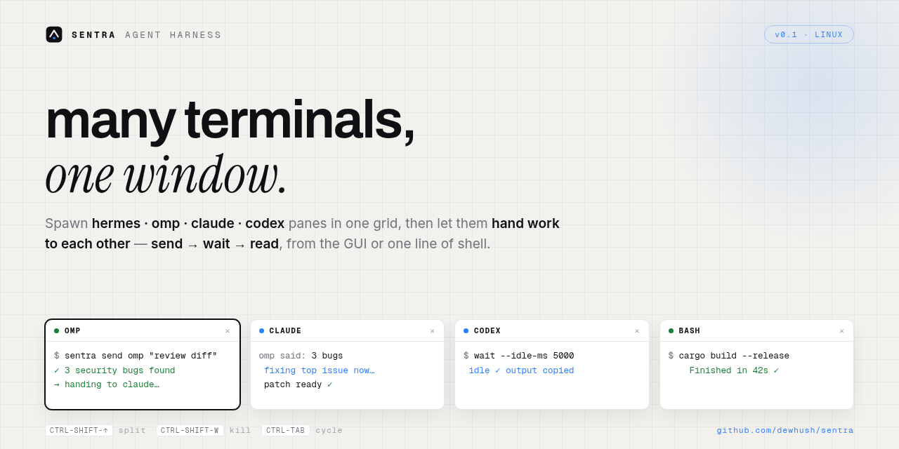

<p align="center">
  
</p>

# sentra

**Many AI-agent terminals, one window — and agents that hand work to each other.**

Sentra is a local agent harness for Linux: spawn any CLI agent (`hermes`, `omp`,
`claude`, `codex`, or any command) into PTY panes, watch them live, and let them
throw work at each other with one triad: **send → wait → read** — from the GUI
(right-click → *Send to…*) or from a shell script.

It is a stripped-down orchestrator. Not an IDE, not a worktree manager, not a
cloud thing.

```
┌──────────┐  unix socket (JSON lines)  ┌──────────────────┐
│ sentra-ui │◄──────────────────────────►│ sentra-daemon     │
│ (viewer)  │  spawn/send/wait/read/…    │  ├ agent 1: PTY   │
└──────────┘  watch → out/exit events    │  └ agent N: PTY   │
┌──────────┐                             │  ring 256K/agent  │
│ sentra    │◄───────────────────────────►│                   │
│ (cli)     │  same verbs, scriptable     └──────────────────┘
└──────────┘
```

## Why it looks like this

- **The daemon owns all agent PTYs.** The Tauri UI is a viewer — if it crashes
  or restarts, your agents keep running. This is the single most important rule.
- **The CLI is the orchestrator API.** Same verbs the UI uses, scriptable:

```sh
sentra send omp "Review this diff and list security bugs: $(git diff)"
sentra wait omp --idle-ms 5000
sentra read omp --tail 4000
sentra send claude "Omp said: $(sentra read omp --tail 4000). Fix the top 3."
```

- **Harness input.** Type `@hermes handle ui @claude front end @omp backend` and
  Enter spawns every mentioned agent at once, one terminal each.

## Features

- 2×2 pane grid (re-flows, depth ≤ 2), xterm.js rendering, live resize
- Roster with live/dead dots, preset chips, one-click spawn
- Handoff UI: send → wait-idle → copy last output
- Auto-learn: on agent exit, save its last output as a lesson and respawn
- Presets from `~/.config/sentra/presets.json` (file wins over bundled defaults)
- Optional TCP listener + web UI: `SENTRA_TCP=127.0.0.1:7621 sentra serve`, then
  any browser on `http://<ip>:7621` gets live xterm panes over SSE

## Install / run

```sh
cargo build --release
./target/release/sentra serve --with-ui   # daemon + UI (starts daemon if missing)
# headless:
./target/release/sentra serve
```

Verbs: `spawn | list | send | wait | read | resize | kill | presets`. All
`--json`-capable. Agent reference is a numeric id or a name, everywhere.

Measured: daemon RSS **3.2 MB** with 5 idle bash agents (budget 30 MB).

## Security notes

The unix socket is same-user only (`$XDG_RUNTIME_DIR/sentra`, mode 700). The
optional TCP/Web listener has **no authentication by design** — localhost or
trusted networks only. See [SECURITY.md](SECURITY.md).

Agents die with the daemon by design (it owns the PTYs). Nothing is persisted
beyond `presets.json`.

## Contributing

PRs welcome — read [CONTRIBUTING.md](CONTRIBUTING.md) first: one design rule,
hard cuts, smoke suite must stay green.

## License

[MIT](LICENSE)

## Contact

Questions or feedback: **dewantorokuntow@gmail.com** or open an
[issue](https://github.com/dewhush/sentra/issues).
